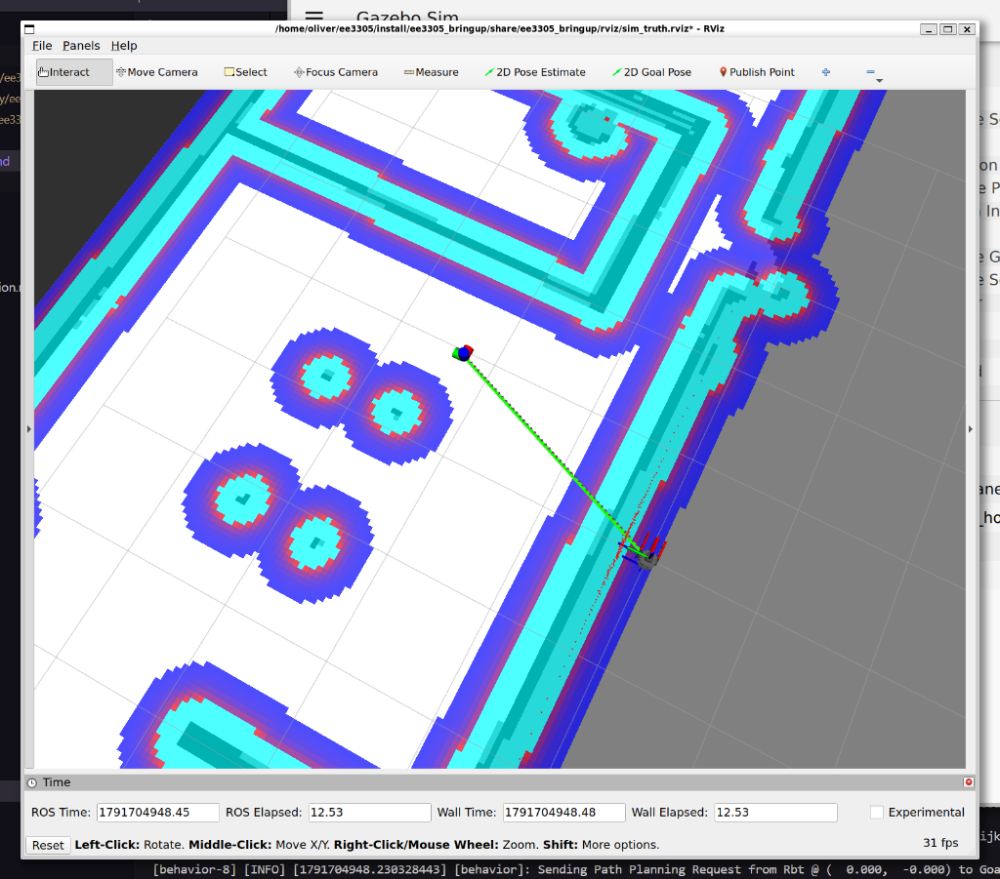
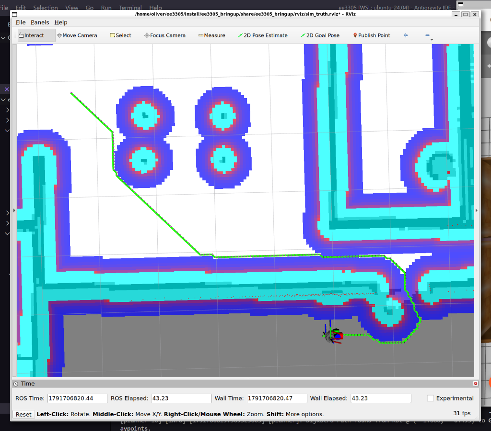
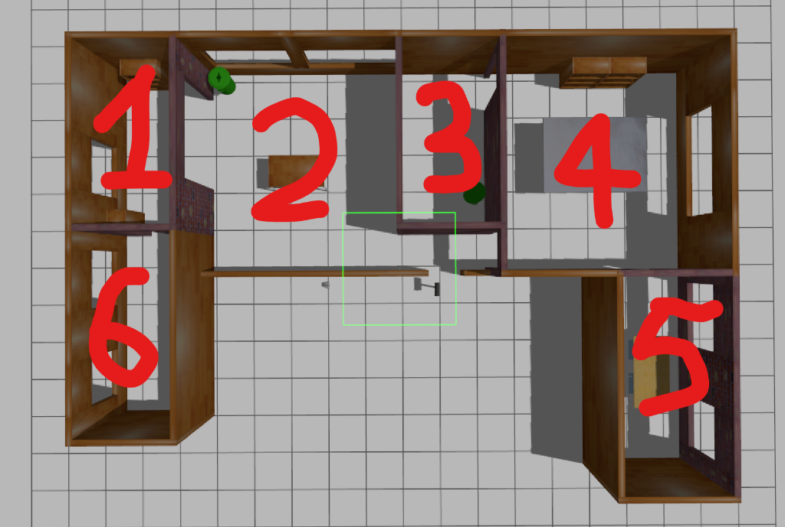
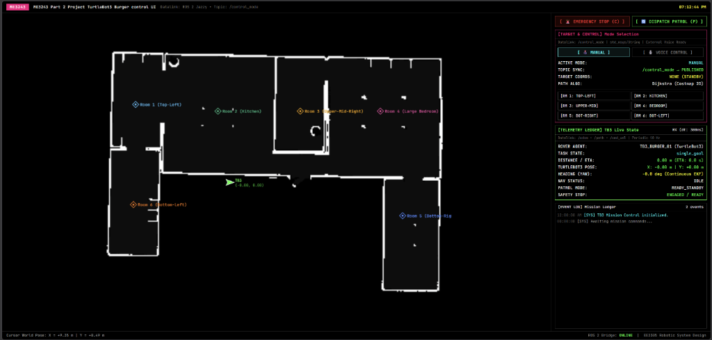
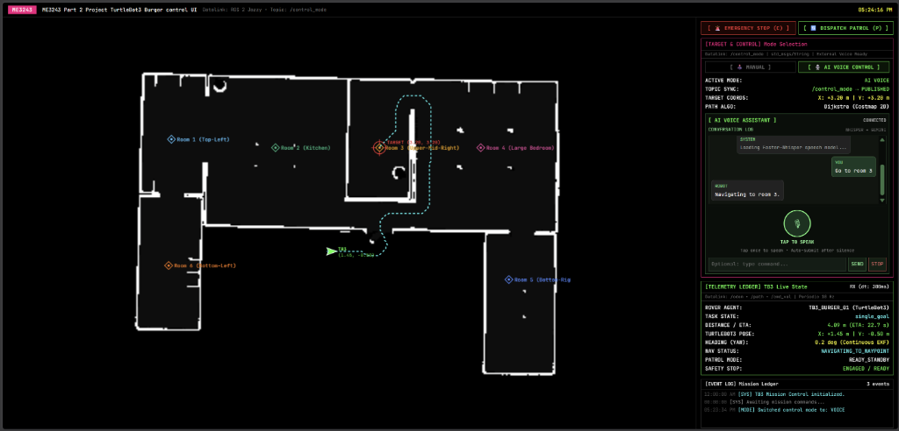

# EE3305 / ME3243 Robotic System Design — Project Implementation Log

**Environment**: Ubuntu 24.04 LTS | ROS 2 Jazzy Jalisco | Gazebo Sim (Harmonic) | Python 3.12  
**Platform**: TurtleBot3 Burger in Gazebo & RViz2  

---

## Quick Start: Launching the Simulation

### 1. Build and Source Workspace
Run from the workspace directory:
```bash
cd ~/ee3305
colcon build --symlink-install
source install/setup.bash
```

### 2. Launch Gazebo, RViz2, and Python Navigation Nodes
```bash
ros2 launch ee3305_bringup run.launch.py cpp:=False headless:=False libgl:=False
```

> **Launch Arguments Guide**:
> * `cpp:=False`: Executes the Python nodes from `ee3305_py` (`behavior.py`, `planner.py`, `controller.py`).
> * `headless:=False`: Opens the Gazebo 3D simulation GUI alongside RViz2. Set to `True` to run Gazebo in the background to save GPU/CPU resources.
> * `libgl:=False`: Uses native GPU acceleration (recommended for WSL2 and dual-boot). Set to `libgl:=True` if running on VirtualBox.

### 3. How to Command the Robot
* **Web Mission Control Dashboard**:
  Open your web browser at **`http://localhost:8080`** for an interactive dark-mode floorplan with one-click room dispatch buttons, live robot tracking, and patrol controls.
* **Manual RViz Navigation**:
  Click the **2D Goal Pose** tool in the RViz2 top toolbar, then click and drag in any room.
* **Dispatch to a Specific Room (Rooms 1 to 6)**:
  Open a second terminal and publish to `/room_goal`:
  ```bash
  source ~/ee3305/install/setup.bash
  ros2 topic pub --once /room_goal std_msgs/msg/Int32 "{data: 4}"
  ```
* **Continuous Multi-Room Patrol Mode**:
  Toggle continuous patrol through Rooms 1 &rarr; 2 &rarr; 3 &rarr; 4 &rarr; 5 &rarr; 6:
  ```bash
  ros2 topic pub --once /patrol std_msgs/msg/Bool "{data: true}"
  ```

---

## 1. Project Overview & Aim

### Project Aim
Implement Dijkstra path planning and Pure Pursuit controller to move a Turtlebot3 robot in a simulated environment.

### Core Navigation Roles
* **Global Planner**: **Dijkstra's Algorithm** (determines the global path from robot pose to goal pose across an inflated 2D occupancy grid costmap).
* **Local Planner / Controller**: **Pure Pursuit Controller** (tracks the global path locally by computing steering curvature and forward linear velocity toward a dynamic lookahead point).
* **Behavior Coordination**: Coordinates high-level states, receives destination goals from RViz, and issues periodic path planning requests.

---

## 2. System Architecture & Communication Pipeline

The system divides navigation responsibilities across three decoupled nodes communicating asynchronously via standard ROS 2 topics:

```
[RViz2: 2D Goal Pose]
         │ /goal_pose
         ▼
+───────────────────+
|   Behavior Node   | ◄─── /odom (from Gazebo)
+───────────────────+
         │ /path_request
         ▼
+───────────────────+
|   Planner Node    | ◄─── /global_costmap (from map_loader)
+───────────────────+
         │ /path
         ▼
+───────────────────+
|  Controller Node  | ◄─── /odom (from Gazebo)
+───────────────────+
    │            │
    │ /cmd_vel   │ /lookahead
    ▼            ▼
[Gazebo]      [RViz2]
```

### Topic Specifications

| Topic | Message Type | Publisher | Subscriber | Purpose |
| :--- | :--- | :--- | :--- | :--- |
| `/goal_pose` | `geometry_msgs/msg/PoseStamped` | RViz2 | Behavior | User-selected destination clicked on the map |
| `/odom` | `nav_msgs/msg/Odometry` | Gazebo Bridge | Behavior, Controller | Robot position and orientation in world frame |
| `/path_request` | `nav_msgs/msg/Path` | Behavior | Planner | Start coordinates `poses[0]` and goal coordinates `poses[1]` |
| `/global_costmap` | `nav_msgs/msg/OccupancyGrid` | Map Loader | Planner | Inflated 2D obstacle cost values (0 to 99) |
| `/path` | `nav_msgs/msg/Path` | Planner | Controller, RViz2 | Ordered sequence of waypoints from start to goal |
| `/cmd_vel` | `geometry_msgs/msg/TwistStamped` | Controller | Gazebo Bridge | Target linear velocity $v$ and angular velocity $\omega$ |
| `/lookahead` | `geometry_msgs/msg/PoseStamped` | Controller | RViz2 | Visual marker of the current lookahead point |

---

## 3. Task 1: Baseline System Implementation & Integration

### 3.1 Sub-Task 1A: ROS 2 Node Connection

Files modified:
* `behavior.py`
* `planner.py`
* `controller.py`

#### 3.1.1 Behavior Node (`behavior.py`)

#### Purpose
Acts as the decision-maker and high-level coordinator of the robot system. It receives destination inputs from the user, monitors the robot's current position from odometry, and periodically requests paths from the planner.

#### Implemented Components
1. **Subscribers**:
   * `sub_goal_pose_`: Subscribes to `goal_pose` (`PoseStamped`, QoS = 10).
   * `sub_odom_`: Subscribes to `odom` (`Odometry`, QoS = 10).
2. **Publisher**:
   * `pub_path_request_`: Publishes to `path_request` (`Path`, QoS = 10).
3. **Callbacks**:
   * `callbackSubGoalPose_`: Stores user-clicked destination coordinates `(goal_x_, goal_y_)` from `msg.pose.position`. Resets `goal_reached_` to allow tracking.
   * `callbackSubOdom_`: Extracts physical robot coordinates `(rbt_x_, rbt_y_)` from `msg.pose.pose.position`.
   * `callbackTimerPlan_`: Runs periodically at 2 Hz. Packages the current robot pose as `poses[0]` and the target goal pose as `poses[1]` into a `nav_msgs/msg/Path` message, then publishes it on `path_request`.

#### Design Rationale: Position vs. Orientation
* In `nav_msgs/msg/Odometry`, `msg.pose.pose.position` contains the physical position $(x, y, z)$ in meters, while `msg.pose.pose.orientation` contains a 4D quaternion $(x, y, z, w)$ representing rotation.
* The behavior node only needs physical 2D coordinates to compute Euclidean distance to the goal (`hypot(dx, dy)`) and to provide start/goal waypoints to the planner. Orientation heading is not needed here, so `position.x` and `position.y` were used.

---

#### 3.1.2 Planner Node (`planner.py`)

#### Purpose
Computes a collision-free path from the robot's current position to the goal using map cost values.

#### Implemented Components
1. **Subscribers & Publisher**:
   * `sub_path_request_`: Subscribes to `path_request` (`Path`, QoS = 10).
   * `pub_path_`: Publishes the generated route on `path` (`Path`, QoS = 10).
   * `sub_global_costmap_`: Subscribes to `global_costmap` (`OccupancyGrid`, latching QoS).
2. **Callbacks**:
   * `callbackSubPathRequest_`: Extracts start coordinates $(x_s, y_s)$ from `msg.poses[0]` and destination coordinates $(x_g, y_g)$ from `msg.poses[1]`. Sets `has_new_request_ = True`.
   * `callbackSubGlobalCostmap_`: Captures the static costmap data array (`msg.data`), grid resolution ($0.05\text{ m}$), world origin coordinates (`origin.position.x/y`), and grid dimensions (`width`, `height`).
3. **Verification Mechanism**:
   * In Step 1, before implementing Dijkstra, `callbackTimer_` invokes `publishInterpolatedPath(...)`. This function creates a straight test line of points spaced every $0.05\text{ m}$ between start and goal to confirm the ROS communication pipeline.

---

#### 3.1.3 Controller Node (`controller.py`)

#### Purpose
Follows the path published by the planner by calculating velocity commands to drive the robot's motors.

#### Implemented Components
1. **Subscribers & Publishers**:
   * `sub_path_`: Subscribes to `path` (`Path`, QoS = 10) and stores waypoints in `path_poses_`.
   * `sub_odom_`: Subscribes to `odom` (`Odometry`, QoS = 10).
   * `pub_cmd_vel_`: Publishes velocity commands on `cmd_vel` (`TwistStamped`, QoS = 10).
   * `pub_lookahead_`: Publishes visual lookahead markers on `lookahead` (`PoseStamped`, QoS = 10).
2. **Callbacks**:
   * `callbackSubPath_`: Updates the internal waypoint list `path_poses_` whenever a valid, non-empty path is published.
   * `callbackSubOdom_`: Extracts current position $(x, y)$ and derives the robot's heading yaw angle ($\phi$).

#### Design Rationale: Quaternion to Euler Yaw Conversion
* ROS 2 represents 3D orientations as unit quaternions:
  $$\mathbf{q} = \begin{bmatrix} q_x & q_y & q_z & q_w \end{bmatrix}^\top$$
* Because the TurtleBot3 operates on a 2D plane, only the planar heading angle (yaw $\phi$, rotation about the $Z$-axis) is required.
* The conversion from unit quaternion to yaw is derived from the rotation matrix:
  $$\Delta y = 2(q_w q_z + q_x q_y)$$
  $$\Delta x = 1 - 2(q_y^2 + q_z^2)$$
  $$\phi = \text{atan2}(\Delta y, \Delta x)$$
* In code:
  ```python
  delta_y = 2.0 * (q.w * q.z + q.x * q.y)
  delta_x = 1.0 - 2.0 * (q.y * q.y + q.z * q.z)
  self.rbt_yaw_ = atan2(delta_y, delta_x)
  ```
* This yields the heading angle $\phi \in [-\pi, \pi]$ radians ($0\text{ rad}$ corresponds to pointing along the positive $X$-axis). The controller requires this angle to know which way the robot is currently facing relative to the path.

---

#### 3.1.4 Verification & Milestone Result



#### Terminal Execution Log:
```text
[behavior-8] [INFO] [behavior]: Sending Path Planning Request from Rbt @ (  0.000,  -0.000) to Goal @ (  0.947,   2.296)
[planner-10] [INFO] [planner]: Publishing interpolated path between Start and Goal. Implement dijkstra_() instead.
```

#### Observations & System Status:
1. **Publish and Subscribe Pipeline Fully Functional**:
   * **Goal Received**: Clicking **2D Goal Pose** in RViz2 successfully published to `/goal_pose`, and `behavior.py` captured the target coordinates $(x = 0.947, y = 2.296)$.
   * **Path Request Dispatched**: `behavior.py` bundled the robot's current coordinates $(0.0, 0.0)$ and the target goal coordinates, successfully publishing to `/path_request`.
   * **Planner & Controller Receiving**: `planner.py` received the request and published waypoints to `/path`. `controller.py` subscribed to `/path` and `/odom`, successfully calculating the robot yaw heading $\phi$ and storing the waypoint array without errors.

2. **Planner Status (Not Yet Implemented)**:
   * Dijkstra's algorithm has **not** been implemented yet.
   * The green line visible in RViz2 is the temporary interpolated straight test path (`publishInterpolatedPath(...)`), which currently passes directly through obstacles.

3. **Controller Status (Not Yet Implemented)**:
   * Pure Pursuit tracking has **not** been implemented yet.
   * The robot remains completely stationary because `controller.py` currently outputs zero velocity commands (`lin_vel = 0.0, ang_vel = 0.0`). Motion tracking will be implemented in Step 2.

---

### 3.2 Sub-Task 1B: Pure Pursuit Controller Implementation

File modified:
* `controller.py`

#### 3.2.1 Concept & Algorithm Overview
Pure Pursuit is a geometric path-following algorithm. At each control step (20 Hz), the controller determines an instantaneous circular arc connecting the robot's current position to a target "lookahead point" located on the path ahead. The curvature of this arc directly dictates the required angular velocity command to steer the differential-drive robot smoothly along the path.

#### 3.2.2 Lookahead Point Selection (`getLookaheadPoint_`)
1. **Find Closest Waypoint**:
   Iterates through all waypoints in `self.path_poses_` to identify the waypoint closest to the robot's current coordinate $(x_r, y_r)$ via Euclidean distance:
   $$d_i = \sqrt{(x_i - x_r)^2 + (y_i - y_r)^2}$$
2. **Search Forward for Lookahead Target**:
   Starting from the closest waypoint index and progressing forward toward the goal, it selects the first waypoint where the distance to the robot meets or exceeds the lookahead distance:
   $$d_i \ge d_{\text{lookahead}}$$
   where $d_{\text{lookahead}}$ is the lookahead distance threshold (`lookahead_distance_`, default $0.1\text{ m}$).
3. **End-of-Path Fallback**:
   If no waypoint is at least `lookahead_distance_` away (which occurs as the robot approaches the end of the path), the final goal waypoint is assigned as the lookahead target.
4. **Visualization**:
   Publishes the selected point coordinates on `/lookahead` (`PoseStamped`) for real-time visualization in RViz2.

#### 3.2.3 Mathematical Derivation & Motion Control (`callbackTimer_`)
1. **Goal Stopping Condition**:
   Before driving, the Euclidean distance from the robot to the destination (the last waypoint in `path_poses_`) is evaluated:
   $$d_{\text{goal}} = \sqrt{(x_{\text{goal}} - x_r)^2 + (y_{\text{goal}} - y_r)^2}$$
   If $d_{\text{goal}} < d_{\text{stop}}$ (where $d_{\text{stop}}$ is `stop_thres_`, default $0.1\text{ m}$), the robot publishes zero velocities ($v = 0, \omega = 0$) and halts.

2. **World to Robot Frame Transformation**:
   Let the lookahead target coordinates in the global map frame be $(x_l, y_l)$, the robot coordinates be $(x_r, y_r)$, and robot yaw heading be $\phi_r$.
   Displacements in world frame:
   $$\Delta x = x_l - x_r, \quad \Delta y = y_l - y_r$$
   Euclidean chord distance to lookahead point:
   $$L = \sqrt{\Delta x^2 + \Delta y^2}$$
   Transforming into the robot-centric reference frame where $+X'$ points forward and $+Y'$ points to the robot's left:
   $$y' = -\Delta x \sin(\phi_r) + \Delta y \cos(\phi_r)$$

3. **Curvature and Angular Velocity Calculation**:
   The instantaneous turning radius $R$ satisfies $2 R y' = L^2 \implies R = \frac{L^2}{2 y'}$.
   The path curvature $c$ is the reciprocal of the turn radius:
   $$c = \frac{1}{R} = \frac{2 y'}{L^2}$$
   Using the target forward linear speed $v = v_{\text{target}}$ (parameter `lookahead_lin_vel_`), the required angular steering velocity $\omega$ is:
   $$\omega = v \cdot c$$

4. **Velocity Saturation / Clamping**:
   To prevent exceeding hardware actuator capabilities and avoid motor burnout:
   $$v = \text{clamp}(v, -v_{\max}, v_{\max})$$
   $$\omega = \text{clamp}(\omega, -\omega_{\max}, \omega_{\max})$$
   where $v_{\max}$ corresponds to `max_lin_vel_` and $\omega_{\max}$ corresponds to `max_ang_vel_`.
   The saturated velocity is published to `/cmd_vel` (`geometry_msgs/msg/TwistStamped`).

---

#### 3.2.4 Verification & Key Observation

#### Observed Behavior:
* When a goal pose was selected in RViz2, the Pure Pursuit controller immediately activated. The robot drove forward, accurately oriented its heading toward the lookahead point, and followed the green line.
* However, because the test path connects the start to the goal in a straight line, the robot attempted to drive straight through walls.

#### Key Conceptual Insight:
* **Controller Has No Map/Obstacle Awareness**: Pure Pursuit is purely a **local trajectory-tracking controller**. Its sole responsibility is converting geometric path error into linear velocity ($v$) and angular velocity ($\omega$) commands for the wheel motors. It does not inspect the costmap, read LiDAR sensor data, or possess any knowledge of walls.
* **Separation of Concerns**: Collision avoidance is the responsibility of the **Global Planner** (Dijkstra's algorithm). The planner must read the costmap to generate a collision-free path around walls; once provided with a valid path, Pure Pursuit will safely track it through doorways and corridors without colliding.

---

### 3.3 Sub-Task 1C: Dijkstra Global Path Planner Implementation

File modified:
* `planner.py`

#### 3.3.1 Concept & Algorithm Overview
Dijkstra's algorithm is a graph search algorithm that finds the shortest (lowest-cost) path between a start node and a goal node. In grid-based robotic navigation, the map is treated as a 2D weighted graph where each grid cell is a node, and edges connect adjacent cells. By incorporating the inflated obstacle cost from `/global_costmap` directly into edge traversal weights, Dijkstra finds a path that is not only geometrically short but also prioritizes wider, safer clearances away from obstacles.

#### 3.3.2 Coordinate Transformations & Grid Mapping
The costmap published by `map_loader` is defined in continuous metric space $(x, y)$ with resolution $\text{res} = 0.05\text{ m/cell}$ and an origin $(x_0, y_0)$ representing the bottom-left corner of the grid in the map frame.

1. **World to Grid Cell (`XYToCR_`)**:
   Converts continuous world coordinates $(x, y)$ to discrete grid column $c$ and row $r$:
   $$c = \left\lfloor \frac{x - x_0}{\text{res}} \right\rfloor, \quad r = \left\lfloor \frac{y - y_0}{\text{res}} \right\rfloor$$

2. **Grid Cell to World (`CRToXY_`)**:
   Converts grid column $c$ and row $r$ back to continuous world coordinates at the cell center:
   $$x = x_0 + (c + 0.5) \cdot \text{res}, \quad y = y_0 + (r + 0.5) \cdot \text{res}$$

3. **2D Grid to 1D Array Index (`CRToIndex_`)**:
   The `nav_msgs/msg/OccupancyGrid` stores cost data in a flat 1D row-major array:
   $$\text{index} = r \cdot \text{width} + c$$

4. **Boundary Validation (`outOfMap_`)**:
   Ensures coordinates reside within grid bounds:
   $$0 \le c < \text{width} \quad \text{and} \quad 0 \le r < \text{height}$$

#### 3.3.3 Priority Queue Node (`DijkstraNode`)
To efficiently extract the cheapest node in $O(\log N)$ time, Python's `heapq` (binary min-heap) is used.
* Each node stores its grid column $c$, row $r$, cumulative cost $g$, and a pointer to its `parent` node.
* A custom comparator `__lt__` is implemented for `heapq`:
  ```python
  def __lt__(self, other):
      if self.g == other.g:
          return (self.c, self.r) < (other.c, other.r)
      return self.g < other.g
  ```
  This ensures strict ordering by lowest $g$-cost, with deterministic coordinate tie-breaking.

#### 3.3.4 Graph Search & Cost Formulation (`dijkstra_`)
1. **Initialization**:
   * The start cell $(c_{\text{start}}, r_{\text{start}})$ is initialized with $g = 0.0$ and inserted into the `open_list` priority queue.
   * A hash map `min_g` tracks the lowest known $g$-cost to each cell coordinate `(c, r)`.
   * A set `expanded` records visited cells to prevent redundant re-expansions.

2. **8-Connected Neighbor Exploration**:
   From the current node $n = (c, r)$, the algorithm explores all 8 adjacent neighbors:
   $$\Delta c \in \{-1, 0, 1\}, \quad \Delta r \in \{-1, 0, 1\} \quad (\text{excluding } \Delta c = \Delta r = 0)$$
   This allows horizontal, vertical, and diagonal movements.

3. **Obstacle Filtering & Cost Function**:
   For each neighbor cell $m = (c + \Delta c, r + \Delta r)$:
   * Check if $m$ is out of map bounds or already in `expanded`.
   * Retrieve the map cost $C(m)$ from `costmap_[CRToIndex_(nb_c, nb_r)]`.
   * If $C(m) < 0$ (unknown space) or $C(m) > C_{\max}$ (parameter `max_access_cost_`, default $90$), the cell is an obstacle and is skipped.
   * The Euclidean step distance is:
     $$\text{dist}(n, m) = \sqrt{(\Delta c \cdot \text{res})^2 + (\Delta r \cdot \text{res})^2}$$
   * The tentative path cost $\tilde{g}$ to reach neighbor $m$ through node $n$ is:
     $$\tilde{g} = g(n) + \text{dist}(n, m) \cdot (C(m) + 1)$$
     The factor $(C(m) + 1)$ penalizes cells with higher inflation costs (near walls), guiding the search toward open corridors with minimal obstacle hazard.

4. **Relaxation & Priority Queue Insertion**:
   If $\tilde{g} < g_{\min}(m)$ (tracked in hash map `min_g`):
   * Update $g_{\min}(m) = \tilde{g}$.
   * Create a new `DijkstraNode` for $m$ with $g = \tilde{g}$ and `parent = n`.
   * Push the node onto `open_list`.

#### 3.3.5 Path Reconstruction & Publishing
1. **Backtracking**:
   When the goal cell $(c_{\text{goal}}, r_{\text{goal}})$ is extracted from the priority queue:
   * The algorithm traces back through `node.parent` pointers until reaching the start node (`parent == None`).
   * Each grid coordinate $(c, r)$ is converted to continuous $(x, y)$ world coordinates using `CRToXY_` and appended as a `geometry_msgs/msg/PoseStamped`.
2. **Reversal & Publication**:
   * The traced poses (initially from goal to start) are reversed so that index `0` is the robot start and the last index is the goal.
   * A `nav_msgs/msg/Path` message is populated with `frame_id = "map"` and published to `/path`.
   * The controller immediately receives the newly planned path and begins Pure Pursuit tracking.
---

#### 3.3.6 Verification & Milestone Result



#### Terminal Execution Log:
```text
[behavior-8] [INFO] [behavior]: Sending Path Planning Request from Rbt @ ( -2.372,   3.735) to Goal @ ( -2.438,   3.788)
[planner-10] [INFO] [planner]: Dijkstra Path Found from Rbt @ ( -2.372,   3.735) to Goal @ ( -2.438,   3.788) with 2 waypoints.
```

#### Observations & System Status:
1. **Collision-Free Global Path Planning Confirmed**:
   * When a destination was selected across the apartment in RViz2, Dijkstra's algorithm successfully planned a collision-free path that safely bypassed all internal walls and doorways.
   * As visible in the RViz2 visualization, the green path correctly navigates around the inflated cost halos (blue/cyan inflation zones) surrounding the walls and the cylindrical obstacle columns in the central living area.
2. **Smooth Pure Pursuit Path Tracking**:
   * The controller accurately followed the generated Dijkstra waypoints in real time, driving the TurtleBot3 out of the bedroom, through the doorway, down the corridor, and safely around the obstacles.
   * Unlike Step 2 (where the straight interpolated line caused the robot to ram into walls), the combination of Dijkstra global planning + Pure Pursuit local control enabled full autonomous obstacle avoidance.
3. **Goal Reached Behavior**:
   * As the robot drew closer to the destination, the behavior node continuously updated the path request with the robot's real-time odometry position.
   * When the robot arrived within the stopping distance threshold ($d_{\text{goal}} < 0.1\text{ m}$), the planned path collapsed to just 2 local waypoints, and the controller successfully brought the robot to a complete stop.

---

## 4. Task 2: Parameter Tuning & Empirical Analysis

*(To be populated)*

---

## 5. Task 3: Algorithmic Improvements & Enhancements

*(To be populated)*

---

## 6. Additional Features

### 6.1 Fixed and Labeled Room Waypoints



#### Room Coordinate Mapping (Matches Annotated Floorplan):
* **Room 1 (Top-Left)**: $(x = -4.20, y = 3.50)$
* **Room 2 (Upper-Middle / Kitchen)**: $(x = -0.50, y = 3.20)$
* **Room 3 (Upper-Right-Middle)**: $(x = 3.20, y = 3.20)$
* **Room 4 (Top-Right / Large Bedroom)**: $(x = 6.80, y = 3.20)$
* **Room 5 (Bottom-Right)**: $(x = 7.80, y = -1.50)$
* **Room 6 (Bottom-Left)**: $(x = -4.30, y = -1.00)$

---

### 6.2 Web-Based Mission Control Dashboard (`http://localhost:8080`)



#### Files Added:
* **`web_gui.py`**:
  * **Purpose**: Dedicated ROS 2 node that integrates a lightweight, multi-threaded HTTP server on port 8080. Bridges browser clients with the ROS 2 computation graph without external web dependencies.
  * Subscribes to `/odom`, `/path`, `/goal_pose`, `/room_goal`, `/patrol`, and `/map`.
  * Ingests the latched `/map` topic (`nav_msgs/OccupancyGrid`) from `map_loader` and dynamically converts it in-memory (`io.BytesIO`) into tactical dark-mode floorplan imagery streamed directly over HTTP (zero image files saved to disk).
  * Exposes REST API endpoints (`/api/status`, `/api/send_room`, `/api/send_goal`, `/api/patrol`, `/api/stop`, `/api/mode`) and publishes `/control_mode` (`std_msgs/String`) to communicate mode switches (`"manual"` vs `"voice"`) to external voice nodes.
* **`index.html`**:
  * **Purpose**: Single-page frontend user interface (**ME3243 Part 2 Project TurtleBot3 Burger control UI**). Built using HTML5 Canvas, Vanilla CSS, and modern JavaScript.
  * Real-time floorplan rendering with dynamic coordinate alignment, live robot pose $(x, y, \text{yaw})$, target crosshairs, and Dijkstra planned path lines.
  * One-click dispatch buttons for Rooms 1 through 6 and continuous automated multi-room patrol toggle.
  * Mode Switcher (`MANUAL` vs `VOICE`): In Voice mode, manual room buttons are hidden, and map canvas clicks / numeric hotkeys are locked out to prevent accidental interference.
  * Live telemetry ledger reporting `TURTLEBOT3 POSE:`, `TASK STATE:` (`single_goal` vs `multi_goal`), distance to goal, estimated time of arrival (ETA), 12-hour mission clock, and timestamped event log.

#### Files Modified:
* **`behavior.py`**:
  * Added `pub_goal_pose_` (`geometry_msgs/PoseStamped`) to broadcast dispatched room and patrol targets to RViz2 and the Web GUI.
  * Added `pub_cmd_vel_` (`geometry_msgs/TwistStamped`) to publish immediate zero velocities upon mission halt or patrol cancellation.
  * Resolved loopback freeze by eliminating redundant recursive publishing on `/stop`.
  * Triggers immediate replanning (`callbackTimerPlan_()`) upon goal dispatch for instant responsiveness.
* **`controller.py`**:
  * Added subscriber to `/stop` (`std_msgs/Bool`) and handled empty path inputs to halt wheel motor velocities immediately upon Emergency Stop.
  * Added resume capability (`is_stopped_ = False` reset upon receiving a valid path) so the robot can immediately resume navigation after an Emergency Stop when a new waypoint is assigned.
* **`planner.py`**:
  * Added empty path broadcast upon receiving an empty path request, clearing path visualizations in RViz2 and Web GUI instantly when halted.

#### Launch Integration (`run.launch.py`):
The Web Mission Control GUI is integrated directly into the main launch file:
* Added the `gui` launch argument to `run.launch.py`, defaulted to `True`.
* Running the standard launch command now automatically launches the simulation, robot state, navigation nodes, and the web GUI server together:
  ```bash
  ros2 launch ee3305_bringup run.launch.py cpp:=False headless:=False libgl:=False
  ```
* Open your browser and navigate to:
  ```
  http://localhost:8080
  ```
  *(To run without the Web GUI, simply append `gui:=False` to the launch command).*

---

### 6.3 Intelligent AI Voice Control System (`me3243_voice_control`)



#### 6.3.1 Overview & System Architecture
An end-to-end voice and natural language command extension integrated seamlessly with the Web Mission Control interface and ROS 2 computation graph. Audio is captured directly via the user's browser using the Web Audio API / `MediaRecorder` and forwarded over HTTP to `web_gui.py`, eliminating WSL2 audio passthrough complications entirely.

```text
Browser Microphone (Web GUI)
          |  POST /api/ai/audio (or typed text: POST /api/ai/text)
          v
Web GUI Server (web_gui.py)
          |  Topics: ai_audio_path / ai_text_command
          v
AI Web Bridge (ai_web_bridge.py)
          |
    +-----+---------------------+
    |                           |
  Audio                       Text
    |                           |
    v                           |
Faster-Whisper (STT)            |
    |                           |
    +-----> Command Parsers <---+
            | gemini_parser.py (Google Gemini LLM)
            | intent_parser.py (Regex / Rule-based Fallback)
            v
     Waypoint Queue (waypoint_queue.py)
            v
   Navigation Manager (navigation_manager.py)
            |
            |  Topic: /room_goal (Int32)
            v
   Shared Autonomous Navigation Pipeline (Behavior -> Planner -> Controller)
```

#### 6.3.2 Live Verification & Execution Walkthrough
As verified in the live integration run shown above:
1. **Mode Switch & Topic Handshake**:
   - The user selects `[ 🎙️ AI VOICE CONTROL ]` in the Web GUI.
   - The GUI publishes `/control_mode` as `"voice"`, locking out canvas misclicks and indicating `TOPIC SYNC: /control_mode -- PUBLISHED`.
2. **Speech Capture & Transcription**:
   - The operator taps the microphone and speaks: *"Go to room 3"*.
   - Built-in silence detection auto-submits the audio buffer to `/api/ai/audio`.
   - The **Faster-Whisper** engine transcribes the audio locally on CPU.
3. **Intent Parsing & Reasoning**:
   - The **Gemini LLM Parser** (`gemini-3.5-flash-lite`) interprets the intent and extracts the target: `{"action": "goto_room", "room": 3}`.
   - Room 3 coordinates $(x = 3.20\,\text{m}, y = 3.20\,\text{m})$ are queried and pushed to the navigation queue.
4. **Speech Synthesis & Conversation Ledger**:
   - The synthesized TTS response *"Navigating to room 3."* is streamed back, logged in the GUI conversation ledger, and dispatched via Edge TTS.
5. **Dijkstra Planning & Pure Pursuit Tracking**:
   - The Behavior node issues a planning request to the Planner node.
   - Dijkstra calculates an optimal, collision-free global path (cyan dotted line).
   - Pure Pursuit controller tracks the curvature in real time, updating live telemetry (`TURTLEBOT3 POSE: X: +1.45 m | Y: -0.50 m`, `DISTANCE / ETA: 4.09 m (22.7 s)`).

#### 6.3.3 Package Structure (`src/me3243_voice_control/`)
* **`ai_web_bridge.py`**: Intermediary bridge node connecting Web GUI HTTP calls with the ROS 2 voice pipeline.
* **`voice_node.py`**: Main ROS 2 voice orchestrator coordinating speech recognition, reasoning, and navigation execution.
* **`speech_to_text.py` & `whisper_worker.py`**: Offline speech-to-text processing using Faster-Whisper.
* **`gemini_parser.py`**: LLM reasoning engine utilizing Google Gemini API for free-form multi-room mission comprehension.
* **`intent_parser.py`**: Robust fallback keyword and regex parser for extracting sequential destinations (e.g., *"Patrol rooms 1, 3, and 5"*).
* **`waypoint_queue.py` & `navigation_manager.py`**: Sequence coordinator handling multi-waypoint dispatch, progress tracking, and goal arrival verification.
* **`text_to_speech.py`**: Audio feedback synthesizer using Edge TTS with live feedback published to `ai_chat_event` and displayed in the Web GUI conversation ledger.

#### 6.3.4 ROS 2 Communication Interfaces
| Topic | Type | Role |
|---|---|---|
| `ai_text_command` | `std_msgs/String` | Typed command string from Web GUI |
| `ai_audio_path` | `std_msgs/String` | Temporary filesystem path of uploaded audio recording |
| `ai_stop` | `std_msgs/Bool` | Instant halt trigger from AI panel |
| `ai_chat_event` | `std_msgs/String` | JSON payload of conversation log events (user, robot, system) |
| `ai_ready` | `std_msgs/Bool` | Heartbeat signal indicating AI backend readiness |
| `/control_mode` | `std_msgs/String` | Toggles between `"manual"` and `"voice"` mode |
| `/room_goal` | `std_msgs/Int32` | Dispatched room waypoint ID (1–6) |

#### 6.3.5 How to Run
1. **API Key Setup**:
   Create a `.env` file in the workspace root (or export the variable in your shell):
   ```bash
   echo 'GEMINI_API_KEY="your_api_key_here"' > .env
   ```
2. **Single-Command Full Stack Launch**:
   ```bash
   ./start_all_with_ai.sh
   ```
   *(Launches Gazebo simulation, robot state publishers, Python navigation nodes, Web Mission Control GUI, and AI Voice Bridge together with automatic virtual environment and `.env` loading).*
3. **Or Launch in Separate Terminals**:
   ```bash
   # Terminal 1: Simulation & Web GUI
   ros2 launch ee3305_bringup run.launch.py cpp:=False headless:=False libgl:=False

   # Terminal 2: AI Voice Bridge
   ./start_ai_bridge.sh
   ```
4. **Operation**:
    * Open `http://localhost:8080` in your web browser.
   * Switch to **`[ 🎙️ AI VOICE CONTROL ]`**.
   * Speak or type natural language instructions (e.g., *"Go to Room 3"*, *"Visit Room 1 then Room 4"*, *"Stop immediately"*).
